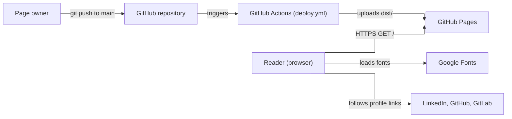
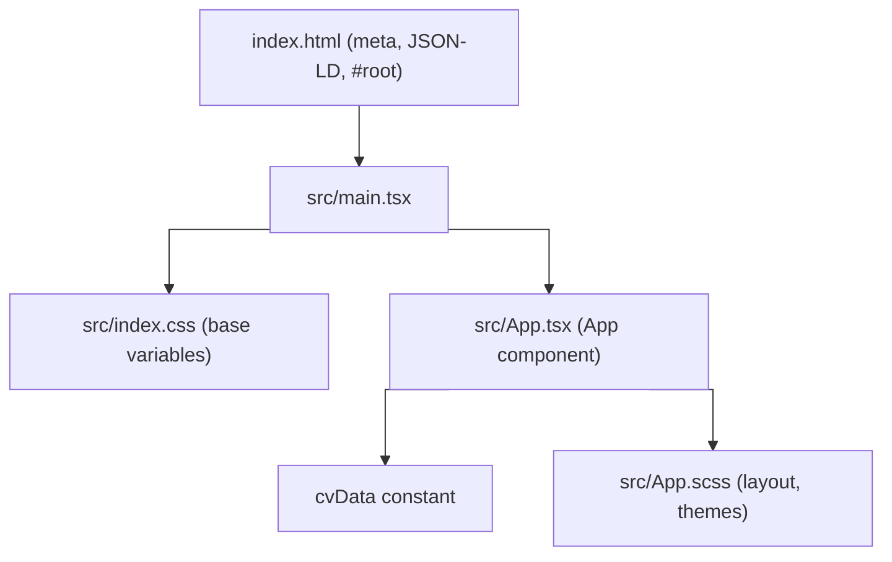
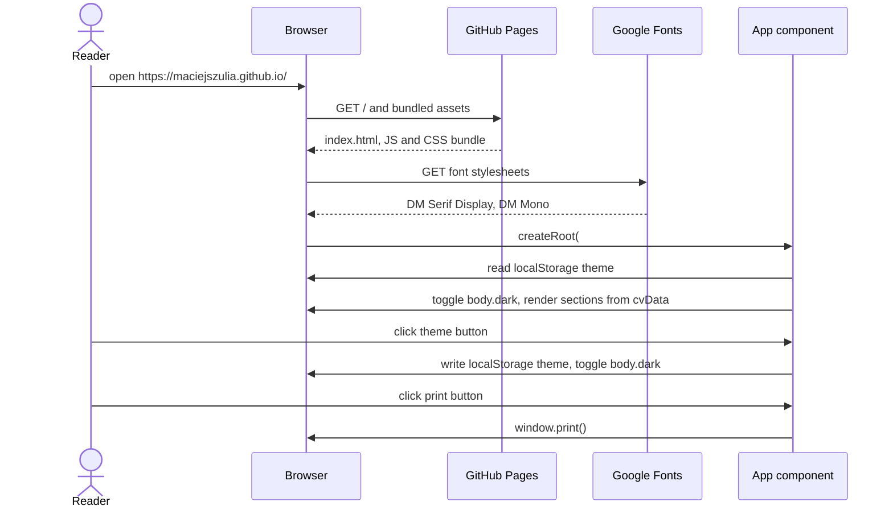

# maciejszulia.github.io architecture

This document describes the architecture of the CV page in the arc42 layout. For setup and commands, start with the [project README](../../README.md).

## 1 Introduction and goals

The repository holds a personal CV page: a single-page React 19 application in TypeScript, built with Vite and published on GitHub Pages at <https://maciejszulia.github.io/>.

Goals:

| Priority | Goal | Where it shows |
|---|---|---|
| 1 | One public page that shows the current CV | `src/App.tsx` renders all sections from the `cvData` constant |
| 2 | Every push to `main` is live without manual steps | `.github/workflows/deploy.yml` |
| 3 | The page can be saved as a PDF | Footer button calls `window.print()` |
| 4 | Search engines understand who the page is about | schema.org `Person` JSON-LD, `<title>` and `<meta name="description">` in `index.html` |

Stakeholders: the page owner, who edits the CV, and recruiters, who read it.

## 2 Constraints

- Hosting: GitHub Pages, static files only; no server-side code.
- Toolchain: Node.js 22 in CI (`actions/setup-node`), npm, Vite 8, TypeScript 6, React 19 (`package.json`).
- Repository name `maciejszulia.github.io` makes it a GitHub user site served from the domain root, so `vite.config.ts` sets no `base`.
- License: none; the README states that no license is granted.

## 3 Context and scope

| Neighbour | Interface |
|---|---|
| GitHub Actions | Runs `npm install`, `npm run lint`, `npm run build`, then `actions/upload-pages-artifact` and `actions/deploy-pages`. |
| GitHub Pages | Serves the built `dist/` folder. |
| Google Fonts | `index.html` loads DM Serif Display and DM Mono stylesheets. |
| Profile sites | Plain links in the contact block of `src/App.tsx`. |

## 4 Solution strategy

- All CV content lives in one TypeScript object, `cvData`, next to the component that renders it ([ADR 0001](adr/0001-cv-content-as-typescript-constant.md)).
- A Vite + React + TypeScript single-page app builds to static files ([ADR 0002](adr/0002-vite-react-typescript-spa.md)).
- GitHub Actions builds and deploys to Pages on every push to `main`, with lint as a gate ([ADR 0003](adr/0003-pages-deploy-with-lint-gate.md)).
- Light and dark themes switch by a CSS class on `body`; the choice is stored in `localStorage` ([ADR 0004](adr/0004-theme-class-and-localstorage.md)).

## 5 Building block view

| Block | Responsibility |
|---|---|
| `index.html` | Document shell: title, description, schema.org `Person` JSON-LD, font links, the `#root` element, the module script. |
| `src/main.tsx` | Mounts `<App />` in `StrictMode` into `#root`; imports `src/index.css`. |
| `src/App.tsx` | Holds `cvData` and renders header, profile, skills, experience, education, languages and footer. |
| `src/App.scss` | Styles, CSS variables for the light theme and the `body.dark` overrides, a breakpoint at 640 px. |
| `src/vite-env.d.ts` | Vite client types and module declarations for `.scss` and `.css` imports. |
| `public/` | Static files copied to the root of `dist/` (`favicon.svg`, `icons.svg`). |

## 6 Runtime view

Main scenario: a reader opens the page.

## 7 Deployment view

| Step | Where | Evidence |
|---|---|---|
| Trigger | Push to `main` or manual `workflow_dispatch` | `.github/workflows/deploy.yml`, `on:` |
| Build | `ubuntu-latest`, Node.js 22: `npm install`, `npm run lint`, `npm run build` (`tsc -b && vite build`) | `.github/workflows/deploy.yml`, `package.json` |
| Publish | `actions/configure-pages@v4`, `actions/upload-pages-artifact@v3` with `./dist`, `actions/deploy-pages@v4` in the `github-pages` environment | `.github/workflows/deploy.yml` |
| Local | `npm run dev`, `npm run preview` | README, "Run locally" |

## 8 Crosscutting concepts

- Theming: CSS custom properties (`--bg`, `--bg2`, `--bg3` and others) in `src/App.scss`; `body.dark` redefines them.
- Responsiveness: one breakpoint, `@media (max-width: 640px)`, stacks the header and the experience grid.
- Printing: the footer button calls `window.print()`; the browser print dialog saves the page as a PDF.
- Search metadata: `<title>`, `<meta name="description">` and a schema.org `Person` JSON-LD block in `index.html`.
- Quality gate: ESLint flat config (`eslint.config.js`) with the recommended JavaScript, TypeScript, React Hooks and React Refresh rules.

## 9 Architecture decisions

- [ADR 0001: CV content as one TypeScript constant](adr/0001-cv-content-as-typescript-constant.md)
- [ADR 0002: Vite, React and TypeScript single-page app](adr/0002-vite-react-typescript-spa.md)
- [ADR 0003: GitHub Pages deploy with a lint gate](adr/0003-pages-deploy-with-lint-gate.md)
- [ADR 0004: Theme by body class, stored in localStorage](adr/0004-theme-class-and-localstorage.md)

## 10 Quality requirements

| Quality | Scenario | Measure |
|---|---|---|
| Deployability | The owner pushes a CV change to `main` | The workflow publishes it without manual steps |
| Maintainability | A lint error is pushed | The `Lint` step fails and Pages keeps the previous version |
| Usability | A reader on a phone opens the page | Layout stacks below 640 px |
| Usability | A reader needs a PDF | One click opens the print dialog |

## 11 Risks and technical debt

- `src/App.css` is not imported anywhere; it is an older copy of `src/App.scss` and can drift from it.
- `src/App.tsx` loads `/photo.jpg`, which is not in `public/`; the `onError` handler hides the image.
- `src/assets/hero.png`, `src/assets/react.svg` and `src/assets/vite.svg` are not imported (template leftovers).
- `tsconfig.app.json` sets `"strict": false`, so the type check misses null and implicit-any errors.
- The deploy workflow runs `npm install`, not `npm ci`, so CI can resolve versions other than `package-lock.json`.
- Interface labels mix Polish (theme and print buttons, section labels) and English (CV content).
- The page depends on Google Fonts at view time; without it the fallback fonts apply.
- There are no `@media print` rules, so the printed PDF also shows the theme and print buttons.
- No automated tests; lint and the TypeScript build are the only checks.

### Open questions

- None.

## 12 Glossary

| Term | Definition |
|---|---|
| CV | Curriculum vitae; the content of `cvData`. |
| `cvData` | The object in `src/App.tsx` that holds every CV field shown on the page. |
| GitHub Pages | GitHub static hosting; serves the `dist/` artifact. |
| JSON-LD | JSON for Linked Data; the schema.org `Person` block in `index.html`. |
| SPA | Single-page application; one HTML document rendered by React. |
